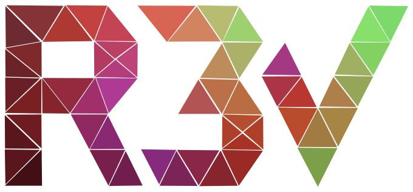
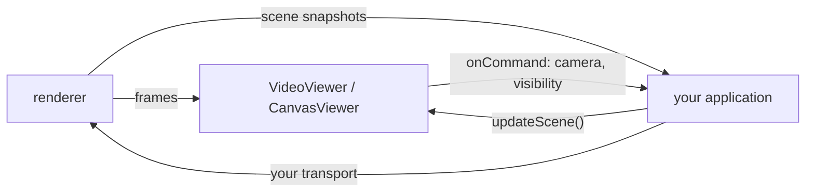

<p align="center">
  
</p>

<h1 align="center">@r3v/web</h1>

<p align="center">
  Headless TypeScript library for showing r3v renderer output in your own web UI.
</p>

<p align="center">
  <a href="https://github.com/igorosky/r3v-web/actions/workflows/ci.yml"></a>
  <a href="https://igorosky.github.io/r3v-web/"></a>
</p>

---

`@r3v/web` puts the output of [r3v-renderer](https://github.com/igorosky/r3v-renderer)
on a `<video>` or `<canvas>` you already have. It keeps track of which scene
elements are visible and turns mouse gestures into camera commands. It draws
no UI of its own and has no runtime dependencies.

## Features

- **`VideoViewer`** shows a `MediaStream` from a remote renderer, for example
  over WebRTC.
- **`CanvasViewer`** shows a renderer running in the page: it draws RGBA
  frames, or lets the renderer draw on the canvas itself (WebGL, WebGPU).
- **Camera gestures**: left drag orbits, right or middle drag pans, the wheel
  zooms. They come out as commands for the renderer.
- **Scene state**: a list of scene elements with their visibility, with
  pending requests and timeouts handled for you.
- **Pause and resume**: the viewer tells you when frames are wanted, so the
  renderer can stop producing them.
- **Optional UI**: `SceneList` from `@r3v/web/ui`, a ready panel with
  visibility switches and camera focus buttons.

## How it fits

The viewer does not talk to the renderer. Your application owns the
connection (WebRTC, WebSocket, rosbridge, a WASM module in the page, ...):



## Install

The package is not on npm yet. Build it from source:

```sh
git clone https://github.com/igorosky/r3v-web.git
cd r3v-web
npm ci
npm run build    # ESM and types in dist/
```

Then add it to your application with `npm install /path/to/r3v-web`.
Building needs Node `^22.12.0 || ^24.0.0 || >=26.0.0`.

## Quick start

A remote renderer streaming video:

```ts
import { VideoViewer } from '@r3v/web';

const viewer = new VideoViewer(document.querySelector('video')!);
viewer.setStream(stream);                                   // e.g. from WebRTC
viewer.onCommand((command) => transport.send(command));     // camera and visibility requests
transport.onSceneSnapshot((snapshot) => viewer.updateScene(snapshot));
viewer.onStatus(({ active }) => transport.setActive(active)); // pause the producer when not needed

// later
viewer.destroy();
```

A renderer running in the page, for example r3v-renderer built for
WebAssembly:

```ts
import { CanvasViewer } from '@r3v/web';

const viewer = new CanvasViewer(document.querySelector('canvas')!);
const frame = new Uint8ClampedArray(width * height * 4);

await renderer.render_rgba(cameraState, frame);
viewer.showFrame({ width, height, data: frame });
```

If the renderer draws on the canvas itself, call `viewer.framePresented()`
after each frame instead of `showFrame()`.

The ready made scene panel:

```ts
import { SceneList } from '@r3v/web/ui';
import '@r3v/web/ui.css';

const list = new SceneList(document.querySelector('#scene')!, viewer);
```

Until the renderer can report its scene, a built-in stub answers locally with
a static list (voxels, rover, manipulator). Turn it off with
`new VideoViewer(video, { dev: { sceneStub: false } })`.

The full API is described in [docs/api.md](docs/api.md).

## Examples

```sh
npm ci
npm run dev
```

| Example | URL | What it shows |
|---|---|---|
| [`examples/basic/`](examples/basic/) | http://localhost:5173/examples/basic/ | Four clients sharing one simulated renderer with 400 ms latency. Each has start/stop, a scene checklist and a toggle that simulates a disconnect. A and B use `VideoViewer`, D uses `CanvasViewer` with `SceneList`, C uses the built-in scene stub. |
| [`examples/janus/`](examples/janus/) | http://localhost:5173/examples/janus/ | The real r3v-renderer streamed over WebRTC through Janus, video only. Camera gestures reach the renderer as ROS 2 topics through rosbridge. |

## Development

```sh
npm run typecheck
npm run lint                      # oxlint with type-aware rules
npm run build                     # ESM and types in dist/
npx playwright install chromium   # once
npm test                          # Vitest in headless Chromium
npm run coverage                  # the same with coverage, report in coverage/
```

Project layout:

- `src/`: the library (`viewer.ts` is the shared base, `video-viewer.ts`,
  `canvas-viewer.ts`, `camera/` gestures, `scene/` scene sync and stub,
  `view/` the video and canvas views, `ui/` the optional `SceneList`).
- `examples/`: the demo pages above.
- `tests/browser/`: Vitest tests that run in Chromium.

The coverage report for master is at https://igorosky.github.io/r3v-web/.
Pull requests with the `coverage` label get a summary comment and the report
as a run artifact, plus a report of the changed lines.

Commits follow [Conventional Commits](https://www.conventionalcommits.org/)
(`feat(ui): ...`, `docs(examples): ...`).

## Part of r3v

| Repository | What it does |
|---|---|
| [r3v-voxelizer](https://github.com/igorosky/r3v-voxelizer) | Point clouds to occupancy voxel map |
| [r3v-renderer](https://github.com/igorosky/r3v-renderer) | Headless renderer for the voxel map and robot models |
| [r3v-ros](https://github.com/igorosky/r3v-ros) | ROS 2 nodes that put both together and publish images |
| **r3v-web** | Browser viewer for the rendered stream (this repository) |
